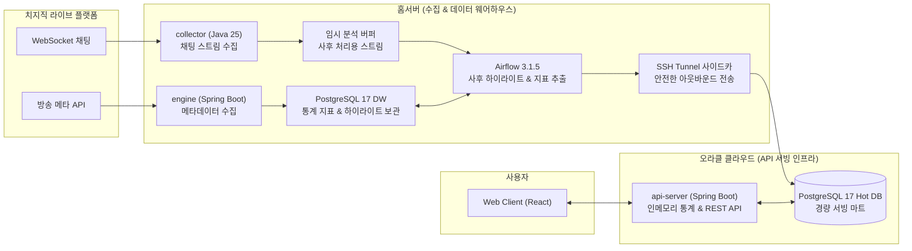

# 🧀 치즈픽 (Cheese-Pick)

치즈픽은 수 시간 분량의 라이브 방송에서 재미있는 클라이맥스를 빠르게 찾기 위한 **하이라이트 타임스탬프 자동 추출**에서 출발하여, 방송의 전 주기를 입체적으로 분석하는 **종합 방송 통계 및 데이터 분석 플랫폼**입니다.

실시간 수집된 채팅 트래픽과 시청자 수 데이터를 바탕으로 방송의 핵심 순간(피크)을 짚어내고, **동시 시청자 변동 추이, 카테고리 전환 구간, 주간 인기 카테고리 및 스트리머 랭킹**을 한눈에 볼 수 있는 리포트를 제공합니다.

---

## ✨ 핵심 기능

- **실시간 고성능 스트리밍 수집**: 수백 개 채널의 실시간 웹소켓 채팅과 방송 메타데이터를 저지연·무손실 버퍼링으로 안정적 수집
- **Airflow 기반 사후 하이라이트 추출**: 방송 종료 후 수학적 통계 알고리즘($Z$-Score, 포아송 LLR 스캔)을 통해 채팅 화력 폭발 구간(하이라이트)과 핵심 키워드(태그)를 자동 탐지
- **하이브리드 데이터 분리 (DW & Hot DB)**: 1억 건 이상의 대용량 시계열은 홈서버 DW(PostgreSQL 17)에 분리 보관하고, 클라우드 DB는 1초 미만 응답을 위한 가벼운 서빙 마트만 유지
- **주간 통합 통계 & 리더보드**: 스트리머 평균 시청자 랭킹과 카테고리별 누적 시청 시간을 매주 월요일 06:00 KST에 자동 집계하여 최신 트렌드 제공
- **데이터 생명주기 및 프라이버시 보호**: 하이라이트 및 비식별 통계 지표만 데이터 웨어하우스에 영구/장기 적재하며, 분석 완료 즉시 원본 채팅 데이터는 보관하지 않고 완전 파기

---

## 🛠️ 기술 스택

### Data Pipeline & Backend
- **Data Pipeline**: Apache Airflow 3.1.5, Python 3.12
- **Backend Core**: Java 25, Spring Boot 4.0.1
- **Database & Cache**: PostgreSQL 17 (DW & Hot DB), Redis 7.2 (캐시 & 메타데이터)
- **Database Migration**: Flyway

### Infrastructure & Operations
- **Hybrid Infra**: On-Premise 홈서버 (수집·분석 DW) + Oracle Cloud ARM (API 서빙 Hot DB)
- **Networking**: Reverse SSH Tunnel Sidecar, Cloudflare Tunnel (Zero Trust)
- **Container**: Docker & Docker Compose
- **Client**: React, TypeScript, Tailwind CSS

---

## 🏗️ 시스템 아키텍처

시스템은 비용 최적화와 안정성을 위해 **홈서버(무거운 수집·DW 연산)**와 **클라우드(24시간 가벼운 웹 서빙)**로 역할을 명확히 분리하여 운영합니다.

---

## 💡 기술적 의사결정

### 1. 사후 배치 분석 전환과 Kafka 제거를 통한 홈서버 리소스 절감
실시간 분석 엔진과 무거운 메시지 브로커(Kafka)를 상시 운영하는 방식 대신, 방송 종료 후 임시 버퍼 스트림을 Airflow가 일괄 분석하는 사후 파이프라인으로 전환했습니다. 불필요해진 Kafka와 실시간 분석기를 제거하여 홈서버 메모리를 8GB 이상 확보했고, 일시적인 트래픽 폭증에도 데이터 유실 위험이 사라졌습니다. 또한 분석 완료 즉시 원본 데이터를 파기하고 비식별 통계 지표만 저장하여 프라이버시와 스토리지 효율을 극대화했습니다.

### 2. 무중단 Hot DB 다이어트 (26GB 디스크 회수 & 인메모리 점진 평균)
클라우드 서빙 DB에 1억 건 이상 쌓이던 대용량 시계열 데이터를 홈서버 DW로 완전히 분리했습니다. 클라우드로의 실시간 쓰기를 차단하고, 방종 시점의 평균 시청자 수를 $O(1)$ 점진적 평균 공식으로 메모리에서 즉시 계산하도록 개선했습니다. 이를 통해 서비스 중단 없이 클라우드 DB 용량을 40GB에서 15GB(점유율 10%)로 60% 이상 대폭 줄였습니다.

### 3. 장기 방송(노방종/켠왕) 대응 무손실 분할 버퍼링 및 자동 복구 파이프라인
수일간 연속 진행되는 대규모 방송에서도 메모리 부족이나 누락이 없도록 30MB 단위 분할 버퍼 청크 롤오버 구조를 설계했습니다. 프로세스 비정상 종료 시에도 손상된 버퍼 스트림을 바이트 레벨에서 자동 복구하여 이어 수집하고, Airflow가 방종 후 다중 청크를 시간순으로 자동 병합 분석하도록 구현했습니다.

### 4. 폐쇄망 홈서버와 클라우드를 잇는 보안 역방향 SSH 터널 사이드카
외부 공인 IP가 없고 포트 개방이 어려운 홈서버의 Airflow가 클라우드 DB로 분석 결과를 안전하게 전달할 수 있도록, 도커 기반 SSH 아웃바운드 터널 사이드카(`slice-oci-db-tunnel`)를 구축했습니다. 외부 침입 위협 없이 안전하게 폐쇄망에서 클라우드로 서빙 데이터를 동기화하는 구조를 완성했습니다.
